# Data Jobs Pipeline

[](https://github.com/Skaipe12/prueba_tecnica_DEIiluma/actions/workflows/ci.yml)

ELT pipeline that loads ~786K job postings (`data_jobs.csv`) into PostgreSQL and models them in third normal form (3NF). Two layers: `raw` keeps the file as it comes, `staging` cleans it with pandas and builds the 3NF tables in `core`.

```
data_jobs.csv
   │  raw layer      CsvReader (10,000-row chunks) → DataFactory (types only) → Validator → RawLoader (COPY)
   ▼
raw.job_postings     faithful copy of the CSV, only typed (TEXT[] skills, JSONB skill types)
   │  staging layer  RawReader → DataFactory (pandas cleaning) → Validator → TableLoader (COPY)
   ▼
core.*               3NF model: 14 tables with primary and foreign keys
```

## Setup and run

You need [uv](https://docs.astral.sh/uv/) (Python 3.12 is pinned) and Docker. Put `data_jobs.csv` in `data/` (not versioned).

```bash
uv sync                          # creates .venv with runtime + dev dependencies
cp .env.example .env             # replace every xxxx (host localhost; port 5432, or 5433 if 5432 is taken)
docker compose up -d             # PostgreSQL 16; wait until `docker compose ps` shows "healthy"
uv run python -m raw.src.main        # CSV -> raw.job_postings (full reload, one transaction)
uv run python -m staging.src.main    # raw -> core (loads only what is new)
```

Run `raw` first. `staging` can be repeated at any time and adds only what `core` does not have. Logs go to the console and to `logs/`. `docker compose down -v` resets the database. `requirements*.txt` are exported from `uv.lock` (`uv export`).

## Project layout

Each layer is self-contained (`src`, `sql`, `tests`) and they share one uv environment, so imports are prefixed (`from raw.src...`).

```
raw/       src/config (constants, .env, logging, psycopg 3 connection)   src/queries (the only class that reads .sql)
           src/resources (CsvReader, DataFactory, Validator, SchemaManager, RawLoader)   src/services/pipeline_service.py
staging/   same structure; resources: RawReader, DataFactory, Validator, KeyResolver, SchemaManager, TableLoader
```

## Data model (3NF)


- **One-to-many:** each job points to one company, platform, location, search location, category and salary rate.
- **Many-to-many:** `job_skills`, `job_schedule_types` and `skill_skill_types` are bridge tables with two foreign keys and a composite primary key, which also prevents duplicate pairs.
- **No job id in the file,** so `jobs.source_row_hash` stores a SHA-256 of the 17 original values. It identifies a posting across layers and makes the load idempotent.

## Design decisions

- **Faithful `raw`.** It only converts types (empty → `NULL`, booleans, timestamps, exact `NUMERIC` via `Decimal`, `TEXT[]`, `JSONB`). Encoding errors, spaces, case, repeated skills and the 101 duplicate rows stay. A cleaning rule can change without re-reading the 231 MB file.
- **No transformation in SQL.** SQL is only DDL, `COPY`, `TRUNCATE` and reads. Transformations are pandas, so the logic could move to PySpark.
- **Country belongs to `search_locations`.** It depends on the search location (0 of 173 have more than one) but not on the job location (1,167 of 17,218 do); in `jobs` it would be a transitive dependency.
- **`job_schedule_type` is atomic.** `"Full-time and Part-time"` is a list written as text (breaks 1NF), and 6 combinations appear in two orders.
- **Bounded memory.** The CSV and `raw` are read in chunks of 10,000 rows (peak ~155–205 MB).
- **Validation in every layer.** Pandera checks the shape of each table before writing (one schema per `core` table, compared in a test with the real table); `NOT NULL`/`CHECK` constraints stay as a safety net.
- **`raw` is atomic:** more than 1% rejected rows, or any error, rolls back and keeps the previous content.
- **`staging` is incremental and idempotent.** One transaction per chunk; the database assigns every id (`IDENTITY`). Per chunk it looks up existing keys, inserts only the new ones and reads back their ids for the foreign keys. A `row_hash` already in `core` is skipped. If a rule changes, drop `core`, recreate it and run `staging`.

### What `staging` does to the data

| Rule | Detail |
|---|---|
| Text | Trimmed, repeated whitespace collapsed, empty → `NULL` |
| Mojibake | Repaired in `job_title` and `company_name` only if the whole text is UTF-8 read as LATIN1 (`México` → `México`; `SÃO PAULO` is left) |
| Platform | Leading `via ` removed |
| Company | Key = lowercase name without final punctuation; name = most frequent spelling |
| Schedule type | Split into atomic values; the anomaly `Kontraktor` is translated to `Contractor` |
| Skills | Lowercased, trimmed, repeats inside a posting removed |
| Salaries | Rounded to 2 decimals, half up (the source has up to 15) |

**Data quality.** A row is rejected, logged with its reason and not loaded if it lacks a value that `core.jobs` requires (1 row has no title) or has a `salary_rate` without an amount (402 rows). Rejected rows stay in `raw`.

**Result on the full file:** 785,741 rows in `raw`; 785,640 distinct (101 exact copies); 785,237 jobs in `core` (785,640 − 402 − 1). Rerunning `staging` loads 0 new jobs. `raw` takes ≈ 84 s; `staging` ≈ 8 min the first time and ≈ 45 s afterwards.

## Evidence from the full run

Screenshots taken on the full file (785,741 rows in `raw`). Tables show their first 20 rows.

### The database

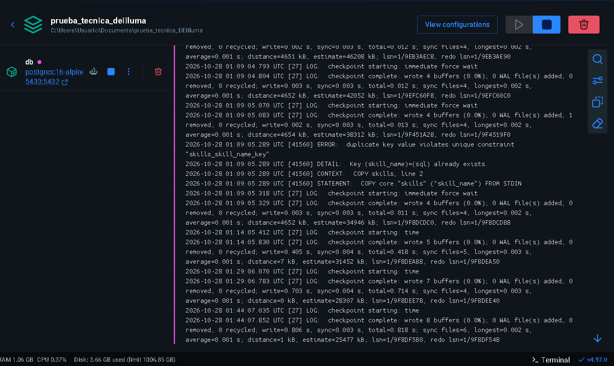

The `db` service of `docker-compose.yml` running `postgres:16-alpine`, with host port 5433 mapped to the container's 5432. The `ERROR ... skills_skill_name_key` in the log is expected: it is the integration test that checks that a duplicate key makes `TableLoader` roll back.

### The result

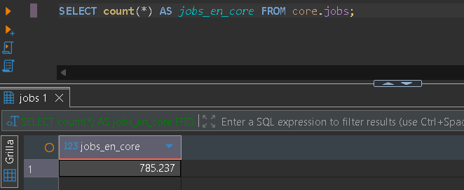

`core.jobs` has 785,237 rows: 785,640 distinct postings in `raw` minus 402 with a salary rate but no amount and 1 without a title.

### The data cleaning, on the same posting

The posting in `raw` and in `core` is joined by `row_hash = source_row_hash`, so each pair is the same row in both layers.

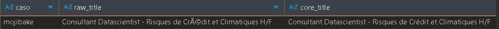

`raw` keeps `Crédit` exactly as the file has it; `staging` repairs it to `Crédit` because the whole text is UTF-8 read as LATIN1.

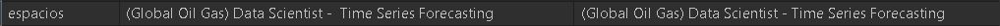

The double space in `Scientist -  Time` is kept in `raw` and collapsed to one in `core`.

### The tables of `core`

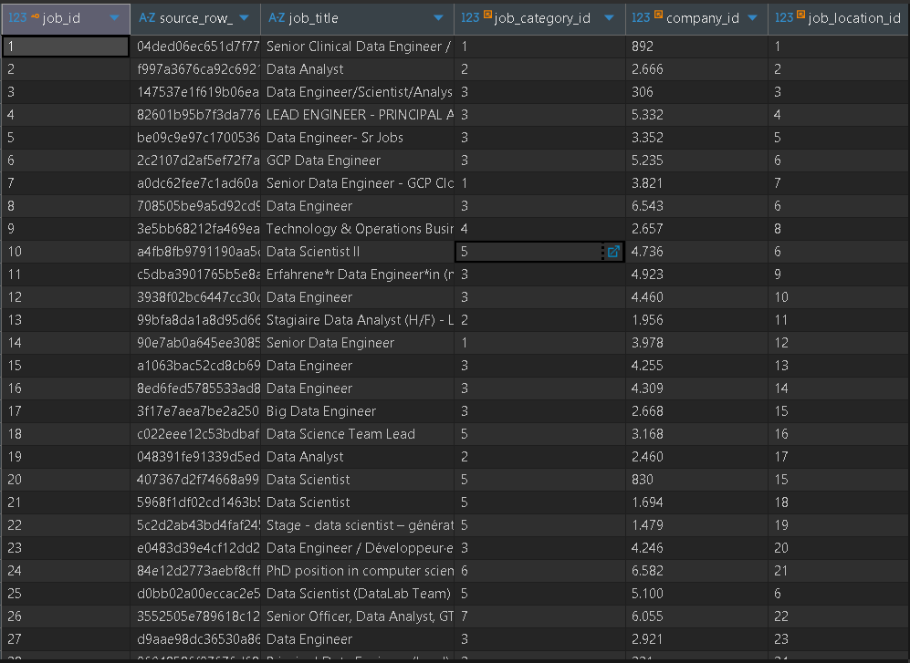

`jobs` holds only the posting and foreign keys. `source_row_hash` is the 64-character SHA-256; ids are assigned by the database. Jobs 6, 8, 10 and 25 share `job_location_id` 6, the location `Anywhere` (below).

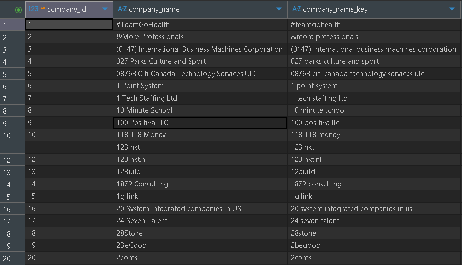

`company_name_key` is the lowercase form used to group spellings; `company_name` keeps the most frequent one. Ids follow the alphabetical order of the key because each chunk is grouped by key before inserting.

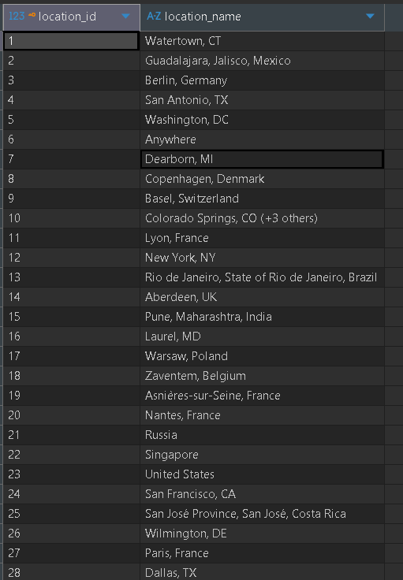

Job locations are stored as written in the file, so `Anywhere` and `Colorado Springs, CO (+3 others)` are valid values of the source.

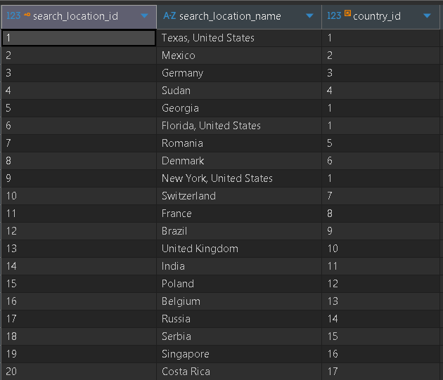

The country hangs from the search location, not from the job (see Design decisions). `Georgia` points to the United States because that is how the file labels it.

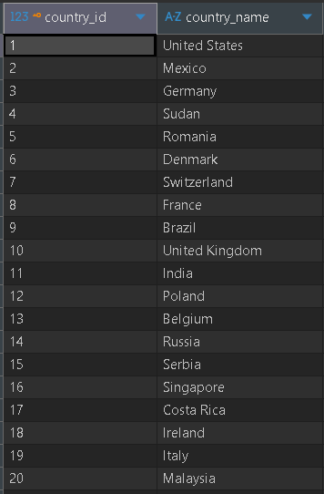

160 countries, numbered in order of first appearance in `raw`.

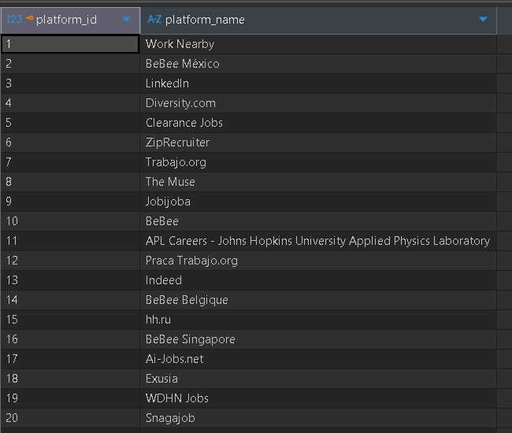

The `via ` prefix is gone. Variants such as `BeBee`, `BeBee México` and `BeBee Singapore` stay as separate platforms, because merging them would be a guess.

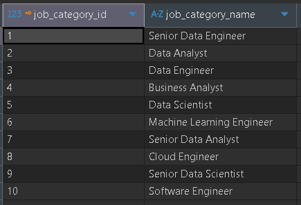

The standardized title (`job_title_short`): only 10 values.

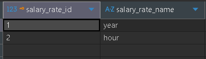

Only `year` and `hour`. `month`, `week` and `day` appeared only in the 402 postings without an amount, which are rejected.

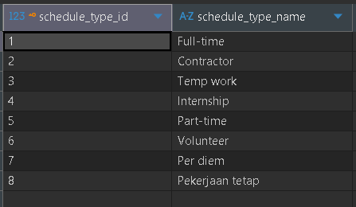

Eight atomic values, never combinations. `Kontraktor` was translated to `Contractor` (id 2); `Pekerjaan tetap` is the other non-English value of the source and is kept.

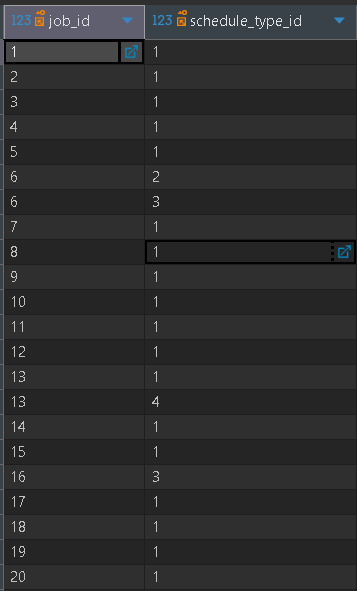

The bridge table that replaces `"Full-time and Part-time"`: job 6 has two rows (types 2 and 3) and job 13 has types 1 and 4.

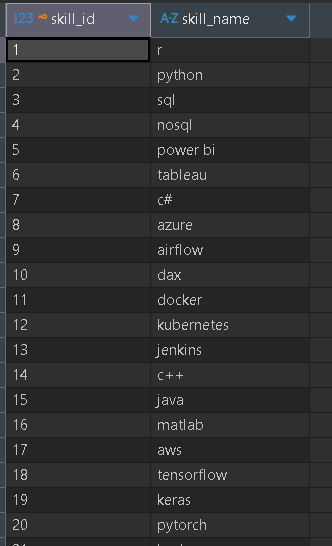

252 skills, lowercase and without repeats, numbered by first appearance.

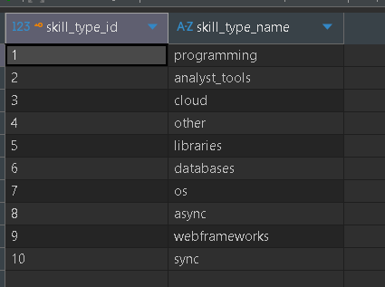

The 10 skill types of the file (`programming`, `analyst_tools`, `cloud`, `libraries`, `databases`...).

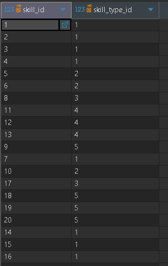

Bridge between skills and their types, with a composite primary key.

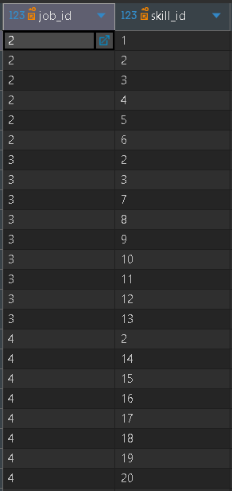

Bridge between jobs and skills. It starts at job 2 because job 1 has no skills (117K postings have none), and jobs 2, 3 and 4 share skill 2.

### The many-to-many relation working

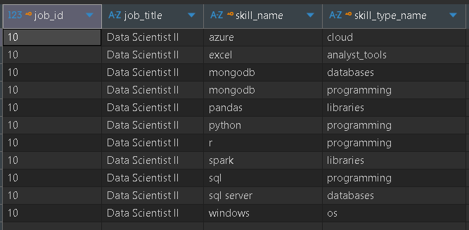

Job 10 joined through the bridge tables. `mongodb` appears twice, once as a database and once as a programming skill, which a single type column could not hold.

### Idempotency

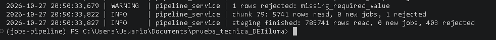

The second run of `staging` reads 785,741 rows and loads 0 new jobs. The 403 rejected rows are logged again with their reason (`missing_required_value` for the posting without a title) because they stay in `raw`.

## Testing

```bash
uv run ruff check .                  # lint
uv run pytest -m "not integration"   # unit tests, no database
uv run pytest                        # everything; integration needs `docker compose up -d`
```

Tests live in each layer. Every integration test creates and drops its own database, so it never touches your data. CI runs lint and the whole suite with a PostgreSQL service container; its credentials belong to a throwaway database that lives only for the job.

## Known limitations

- Rows identical in all 17 columns count as one job: two real openings with the same values cannot be told apart from a scraper duplicate.
- Platforms have ~7,900 variants (`BeBee`, `BeBee India`…) and are not merged; some company names look like people (possible recruiters). Titles cut with `...` (about 2%) cannot be recovered.
- Mojibake is only repaired when safe: 14 titles and 13 companies keep `Ã`/`Â` because they are legitimate letters or truncated text.
- `company_name` keeps the most frequent spelling of the chunk where the company first appears; later chunks do not rename it.
- `JSONB` does not keep the key order of a dictionary. An empty and a missing value are both `NULL` in `raw`.
- Not done: an OLAP / reporting model on top of `core`.
