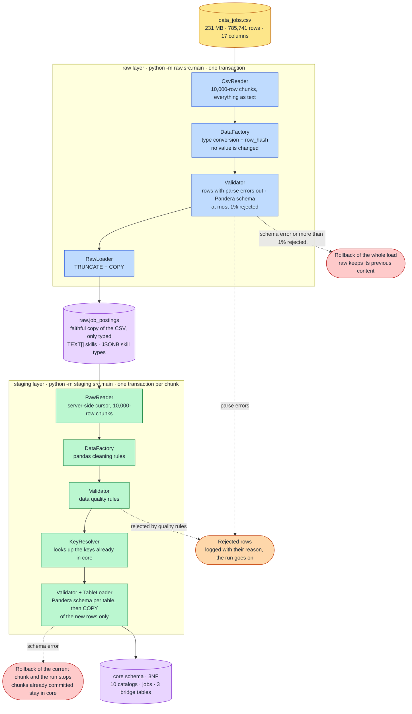
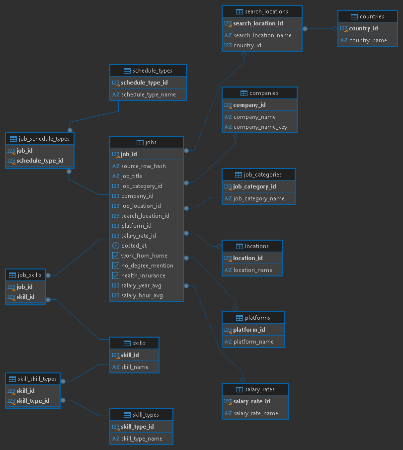

# Data Jobs Pipeline

[](https://github.com/Skaipe12/prueba_tecnica_DEIiluma/actions/workflows/ci.yml)

ELT pipeline that loads ~786K job postings (`data_jobs.csv`) into PostgreSQL and models them in third normal form (3NF). Two layers: `raw` keeps the file as it comes, `staging` cleans it with pandas and builds the 3NF tables in the `core` schema.

Evidence of a full run (row counts, every table, the cleaning on real rows, idempotency and the running database) is in [docs/Full Run Evidence — Job Postings Pipeline.pdf](<docs/Full Run Evidence — Job Postings Pipeline.pdf>).

## Setup and run

**Requirements:** [uv](https://docs.astral.sh/uv/) (Python 3.12 is pinned in `.python-version`), Docker, and the `data_jobs.csv` file.

```bash
# 1. Get the code and the environment
git clone https://github.com/Skaipe12/prueba_tecnica_DEIiluma.git
cd prueba_tecnica_DEIiluma
uv sync                              # creates .venv with runtime + dev dependencies

# 2. Configure the database credentials
cp .env.example .env                 # replace every xxxx; host localhost, port 5432 (5433 if 5432 is taken like in my case)

# 3. Start PostgreSQL and add the data
docker compose up -d                 # PostgreSQL 16; wait until `docker compose ps` shows "healthy"
# copy data_jobs.csv into data/

# 4. Run the pipeline, in this order
uv run python -m raw.src.main
uv run python -m staging.src.main
```

Both commands log to the console and to `logs/`. `staging` can be run again at any time: it only adds what `core` does not have yet. To check the result:

```sql
SELECT count(*) FROM core.jobs;      -- 785237
```

`docker compose down -v` deletes the database for a full reset. `requirements*.txt` are exported from `uv.lock` for tools that need them.

## Testing Guide

```bash
uv run pytest -m "not integration"   # 137 unit tests, no database needed (~7 s)
uv run pytest -m integration         # 32 integration tests, need `docker compose up -d` (~13 s)
uv run pytest                        # everything
uv run ruff check .                  # lint
```

Unit tests cover the cleaning rules, the type conversions and the Pandera schemas, without a database. Each integration test creates its own throwaway database and drops it at the end, so it never touches the data you loaded. CI (GitHub Actions) runs the lint and the whole suite with a PostgreSQL service container.

## Design Decisions

### Architecture: ELT in two self-contained layers



- **ELT, with a faithful `raw`.** `raw` only converts types: empty text → `NULL`, booleans, timestamps, exact `NUMERIC` through `Decimal` (never `float`), skills → `TEXT[]`, skill types → `JSONB`. Encoding errors, spaces, case, repeated skills and the 101 duplicate rows stay as they are. This keeps the source auditable, and a cleaning rule can change and be re-applied without re-reading the 231 MB file.
- **`raw` and `staging` are independent.** Each layer has its own `src`, `sql`, `tests` and entry point (`python -m raw.src.main`, `python -m staging.src.main`), like two jobs of an orchestrator, over one shared uv environment. A layer fails, retries or changes without touching the other.
- **No transformation is written in SQL.** SQL is limited to DDL, `COPY`, `TRUNCATE` and reads, and lives in `.sql` files read by one class per layer. All cleaning is pandas, so it is testable with plain unit tests and the same logic could move to PySpark if the data grew.
- **Layers by responsibility.** `config` (constants, `.env`, logging, connection), `queries` (the only SQL access), `resources` (single-purpose classes: reader, factory, validator, loader), `services` (the pipeline: order of steps, transactions, logs) and `main` (builds the objects and injects them). Dependencies are passed by constructor, which is what makes each piece testable.

### Tools

- **PostgreSQL 16** in Docker Compose: a relational model with real constraints, and `COPY` for fast loads. The schema is created by the code (`SchemaManager`), not by Docker, so it works the same locally and in CI.
- **psycopg 3, no ORM.** The job is bulk loading, not object mapping. `cursor.copy()` streams each chunk to PostgreSQL much faster than row inserts, and `Jsonb` and array types map directly.
- **pandas + Pandera.** pandas does the chunked transformations. Pandera declares the expected shape of every table (columns, order, types, nulls, uniqueness) in one line per column, so a bad frame fails before it is written. A test compares each schema with the real table.
- **uv + GitHub Actions + pre-commit + ruff.** `uv.lock` pins the dependencies for the same environment locally and in CI; CI runs lint and the full suite (unit and integration) against a PostgreSQL service on every push. Credentials only come from `.env`.

### The 3NF model



`jobs` is the centre; ten catalogs and three bridge tables hang from it. Primary keys are surrogate `IDENTITY` ids, natural keys are `UNIQUE`, and every relation is a foreign key with an index.

- **First normal form: `job_schedule_type` is atomic.** `"Full-time and Part-time"` is a list written as text. It is split into single values (`Full-time`, `Part-time`, `Contractor`, `Temp work`, `Internship`, `Volunteer`, `Per diem`, `Pekerjaan tetap`) and linked through `job_schedule_types`. This also removes false variants: 6 combinations appear in two orders in the file.
- **Many-to-many with bridge tables.** A job has several skills and a skill is in many jobs (`job_skills`); a skill can belong to several types, as `mongodb` is both a database and a programming skill (`skill_skill_types`). Each bridge has a composite primary key, so a pair cannot repeat.
- **Third normal form: the country hangs from `search_locations`, not from `jobs`.** Measured on the full file, the country depends on the search location (0 of 173 have more than one) but not on the job location (1,167 of 17,218 do). Storing it in `jobs` would be a transitive dependency.
- **Companies have a key.** `company_name_key` (lowercase, no final punctuation) is the unique key and `company_name` keeps the most frequent spelling, so `PHILIPS` and `Philips` are one company.
- **Types and constraints reflect the data.** Salaries are `NUMERIC(12,2)` and `NUMERIC(10,2)` with `CHECK >= 0`; `NOT NULL` where the model requires it. They act as a safety net behind the Pandera validation.
- **The file has no job id,** so `jobs.source_row_hash` stores a SHA-256 of the 17 original values (`raw.row_hash` holds the same value). It identifies a posting across layers, collapses the exact duplicates (94 groups, 101 extra copies) and makes the load idempotent.

#### Questions I asked myself while building the model

**How did I identify the entities?** The CSV is one wide table: every row is a posting that repeats everything around it, with the company, the platform and the place written out in full each time. I profiled the whole file first and then asked every column the same five questions. Is it something that exists on its own (a company, a platform, a skill)? Does it repeat across many postings? If it changes, should it change in one place only? Does it depend on the posting, or on another column? Is it a list packed into one cell? A "yes" to the first three gave a table of its own; a "yes" to the fourth moved the column next to what it depends on; a "yes" to the last one gave a bridge table.

**What criterion decided that something deserved its own table?** Repetition measured on the real data, not intuition. About 140,000 company spellings are ~129,000 real companies, ~7,900 platforms repeat over 785K postings, 17,218 distinct job locations, 252 skills. What describes only that posting (title, date, remote, insurance, salaries) stays in `jobs`.

**Where does the country belong?** My first instinct was next to the job location, so I tested it instead of assuming it: 1,167 of 17,218 job locations appear with more than one country, but 0 of the 173 search locations do. The country depends on the search that found the posting, so it hangs from `search_locations`. In `jobs` it would be the transitive dependency posting → search → country.

**What do I do with a list inside a cell?** `job_skills` and `job_schedule_type` are lists written as text, which breaks first normal form. I turned each into a bridge table. For schedules I first thought about a catalog with the values as they come, but `"Full-time and Part-time"` and `"Part-time and Full-time"` would then be two different values for the same thing, so I split them into 8 atomic values.

**Can a skill have more than one type?** Yes: `mongodb` is both a database and a programming skill. A `type` column in `skills` could not hold it, so `skill_skill_types` is a many-to-many bridge with a composite key.


**Which identity is a company?** `Philips`, `PHILIPS` and `philips` are the same company. I group them by a normalized key (lowercase, no final punctuation) and keep the most frequent spelling as the name. I did not try to merge `BeBee` and `BeBee India` platforms or to detect companies that look like people: those would be guesses about the data, so I documented them as limitations.

**How do I identify a posting if the file has no id?** I hash the 17 original values. The same hash lives in `raw` and `core`, so I can trace a row across layers and run the load twice without duplicating anything. The price is that two real openings with identical values count as one.

**Surrogate or natural keys?** Natural keys here are long, free text that could be corrected later, so every table has a surrogate `IDENTITY` primary key and the natural key stays `UNIQUE`. Foreign keys are small integers and a rename touches one row.


### The ETL method

- **Bounded memory.** The CSV and `raw` are read in chunks of 10,000 rows, so the file is never fully in memory (peak ~155–205 MB for 231 MB).
- **`raw` is a transaction.** Truncate and load happen together: more than 1% of rejected rows, or any error, rolls back and keeps the previous content.
- **`staging` is incremental and idempotent.** One transaction per chunk, and the database assigns every id. For each chunk it looks up which keys already exist, inserts only the new ones, reads back their ids to fill the foreign keys and bridge tables, and skips any posting whose `row_hash` is already in `core`. Running it twice changes nothing; if a cleaning rule changes, drop `core`, recreate it and run `staging`.
- **Cleaning rules (one method each).** Text trimmed and repeated whitespace collapsed; mojibake repaired in `job_title` and `company_name` only when the whole text is UTF-8 read as LATIN1 (`México` → `México`, but `SÃO PAULO` is left); the `via ` prefix removed from platforms; skills lowercased and de-duplicated per posting; salaries rounded to 2 decimals; the anomaly `Kontraktor` translated to `Contractor`.
- **Data quality.** A row is rejected, logged with its reason and not loaded if it lacks a value `core.jobs` requires (1 row has no title) or has a `salary_rate` without an amount (402 rows). Result: 785,741 rows in `raw`, 785,640 distinct, 785,237 jobs in `core`.
